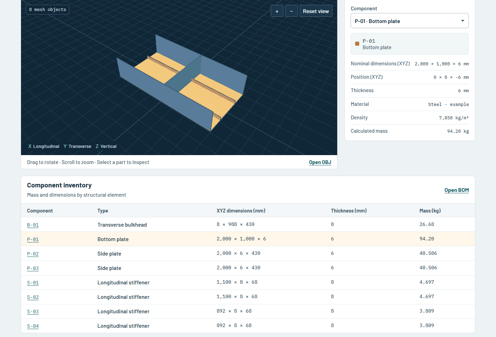
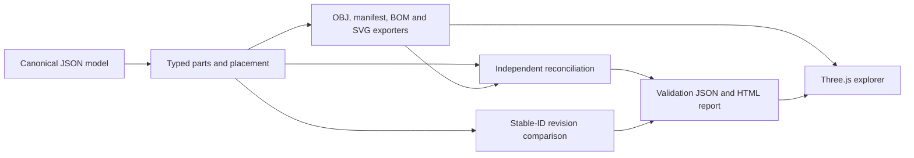

# HULLGUARD QA

**Catch ship-structure changes that leave geometry, bills of materials, or drawings out of sync.**

[Open the live demo](https://chirayukapoor5.github.io/hullguard-qa/) · [Plate editor](https://chirayukapoor5.github.io/hullguard-qa/#editor) · [Case study](docs/CASE_STUDY.md) · [GitHub Actions](https://github.com/chirayukapoor5/hullguard-qa/actions)

Edit a steel plate from 6 mm to 8 mm, inspect the actual 3D export, reconcile the expected **+31.4 kg** mass change, and reproduce the failure caused by retaining an old BOM or drawing.

Independent educational engineering QA project. Not affiliated with, endorsed by, or integrated with NAPA.



## What it checks

- **Source model.** Valid units, material and density, unique component IDs, supported dimensions, bottom placement, and no positive-volume intersections.
- **Export consistency.** Re-imports the OBJ, manifest, BOM and schematic SVG. Checks named mesh components, topology, bounds, dimensions, mass, drawing annotations, and canonical revision hashes.
- **Revision impact.** Reports changes in identity, thickness, dimensions, position and mass. A candidate bundle can be compared with regenerated outputs to expose stale evidence.
- **Live plate editor.** Enter a thickness to calculate geometry and mass changes in the browser. Download the revised canonical JSON and regenerate the exports with the CLI.
- **Review workflow.** Browse the 3D model, compare revisions, and inspect precomputed Python QA evidence, six controlled faults, and their reproduction commands.
- **Optional CAD exchange.** Generate editable FreeCAD boxes and per-component STEP solids. Reopen both representations and reconcile measured geometry and mass against the canonical model. [FreeCAD setup and evidence](docs/CAD_INTEROP.md)

## Engineering example

The open structural bay contains a bottom, two side plates, one transverse bulkhead and four longitudinal flat bars. The top of the bottom plate is the Z datum. The 8 mm plate extends 2 mm farther down, preserving the placement of the other parts.

| Measurement | Baseline | Revised | Change |
| --- | ---: | ---: | ---: |
| P-01 steel volume | 0.012 m³ | 0.016 m³ | +0.004 m³ |
| P-01 mass | 94.2 kg | 125.6 kg | +31.4 kg |
| Assembly mass | 218.9052256 kg | 250.3052256 kg | +31.4 kg |

The plate calculation uses `2.0 m × 1.0 m × thickness in m × 7,850 kg/m³`. A separate decimal reconciliation verifies exported masses and a fractional reference independently checks the assembly total. See [domain assumptions](docs/DOMAIN_ASSUMPTIONS.md).

## Quick start

Use Python 3.11+ and either Node 22.12+ in the 22.x release line or Node 24+. Open a shell and prepare the project.

```sh
git clone https://github.com/chirayukapoor5/hullguard-qa.git
cd hullguard-qa
python -m venv .venv
```

Activate with `source .venv/bin/activate` on Linux or `.venv\Scripts\Activate.ps1` in PowerShell. If PowerShell script activation is disabled, use `.venv\Scripts\python.exe` in place of `python` below.

```sh
python -m pip install -e ".[dev]"
cd frontend
npm ci
npx playwright install chromium
cd ..
python scripts/verify.py
```

On Linux, use `npx playwright install --with-deps chromium` if the browser's OS libraries are missing. The verification command returns a nonzero exit on failed or blocked required stages. Use `--skip-browser` only to request a recorded browser skip when Chromium is unavailable.

To serve the compiled demo after verification, run `npm run preview` in `frontend/` and open the local address Vite prints. For development, run `python -m hullguard demo` from the repository root, then `npm run dev` in `frontend/`. Serve the site over HTTP so it can load the evidence files.

### CLI reproduction

```sh
python -m hullguard check fixtures/baseline.json
python -m hullguard export fixtures/baseline.json build/baseline
python -m hullguard compare fixtures/baseline.json fixtures/thickness_changed.json build/revised
python -m hullguard demo
python -m hullguard validate frontend/public/data/faults/stale_bom/model.json frontend/public/data/faults/stale_bom
```

The final command exits **1**. Read `STALE_REVISION` and the P-01 mass finding. The expected mass is 125.6 kg and the observed stale value is 94.2 kg. Exit **0** indicates pass and **2** indicates invalid input or usage. Add `--against build/baseline` to the comparison command to include an old candidate bundle and exit nonzero for its findings.

## Architecture and evidence

Verification passed **104 core Python tests**, **9 Chromium regression tests**, and **7 optional FreeCAD tests**. Core coverage was **98.29% combined line and branch**. A separate scripted audit reproduced the 24 manual cases with recorded output and screenshots. Human manual execution remains 0/24.



- [Execution report](docs/TEST_EXECUTION_REPORT.md) and dated [verification summary](reports/review/verification-summary.json) include measured results, tooling and execution scope. Reruns generate JUnit XML, Cobertura XML and JSON in `reports/`.
- [GitHub Actions](https://github.com/chirayukapoor5/hullguard-qa/actions) runs the Windows and Linux jobs and publishes the verified static bundle through GitHub Pages. The Linux job also runs browser acceptance.
- [Manual execution audit](docs/MANUAL_EXECUTION_REPORT.md), [manual test plan](docs/MANUAL_TEST_PLAN.md), [24 manual cases](docs/MANUAL_TEST_CASES.md), [controlled defect reports](docs/DEFECT_REPORTS.md), and [requirements traceability](docs/REQUIREMENTS_TRACEABILITY.md) show the review and reproduction design.

## Scope and documentation

Rectangular, axis-aligned solids and one example steel density define the supported model. The schematic plan illustrates simplified dimensions. FreeCAD exchange covers the generated boxes and per-component STEP. Classification, structural strength, finite-element analysis, production drawings, and commercial ship-design integration are outside scope. [Principal QA review](docs/PRINCIPAL_REVIEW.md)

| Audience | Start here |
| --- | --- |
| Recruiter or hiring panel | [Case study](docs/CASE_STUDY.md) · [90-second demo](docs/DEMO_SCRIPT.md) · [CV bullets](docs/RESUME_BULLETS.md) |
| QA lead | [Requirements](docs/PRODUCT_REQUIREMENTS.md) · [Test strategy](docs/TEST_STRATEGY.md) · [Risk register](docs/RISK_REGISTER.md) · [Documentation QA](docs/DOCUMENTATION_REVIEW.md) |
| Technical reviewer | [Engineering design review](docs/ENGINEERING_DESIGN_REVIEW.md) · [Research](docs/RESEARCH.md) · [Interview preparation](docs/INTERVIEW_PREPARATION.md) · [Portfolio evaluation](docs/PORTFOLIO_EVALUATION.md) |

HULLGUARD QA is [MIT licensed](LICENSE). The demo uses Three.js under the MIT License and Barlow and IBM Plex Mono under the SIL Open Font License. Their notices are included with the [static assets](frontend/public/licenses/).
